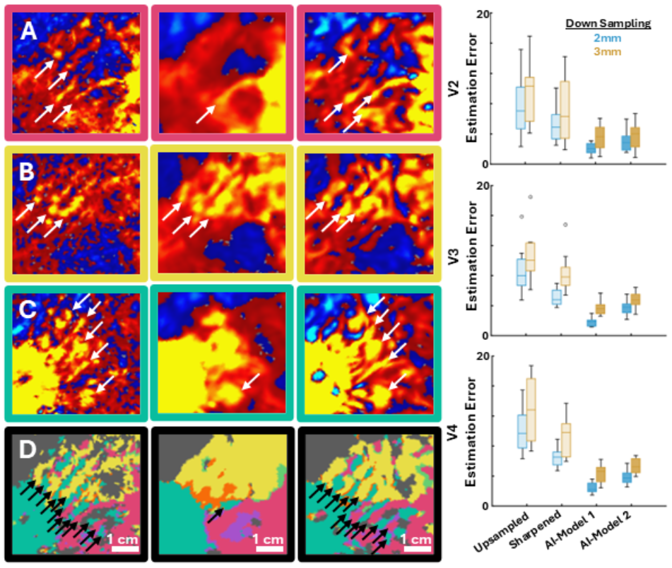

# f-LENNS

**f**unctional **L**ocalization **E**nhancement via **N**eural-**N**et **S**harpening — AI-based super-resolution of functional MRI to 1 mm isotropic resolution.

[](https://arxiv.org/abs/XXXX.XXXXX)
[](LICENSE)

f-LENNS takes a conventional-resolution fMRI scan (3D or 4D NIfTI/MGZ) and produces a 1 mm isotropic version of it, recovering mesoscale functional organization that is normally accessible only with ultra-high-field scanners and long acquisitions. A **single pretrained model** works across field strengths (3T and 7T), pulse sequences (including BOLD and VASO), voxel sizes, and experimental paradigms — **no retraining, fine-tuning, or parameter tuning**.

> **Paper:** Nasr S., Li H.B., Rosen M.S., Iglesias J.E. *Accessing Mesoscale Functional Organization from Standard Functional MRI Leveraging AI-Based Super-Resolution.* arXiv:XXXX.XXXXX (placeholder — the preprint has not been posted yet).

<p align="center">
  
</p>

<p align="center">
<em>Motion- (A), disparity- (B) and color-selectivity (C) maps and their interdigitation (D) in early visual cortex. Left: 1 mm acquisition. Middle: the same data downsampled (2&nbsp;mm). Right: f-LENNS reconstruction. Right-hand panels: error in estimating patch size in V2, V3 and V4 for upsampling, sharpening, and two models trained on real fMRI.</em>
</p>

---

## Contents

1. [How it works](#how-it-works)
2. [Installation](#installation)
3. [Model weights](#model-weights)
4. [Usage](#usage)
5. [What to expect](#what-to-expect)
6. [Troubleshooting](#troubleshooting)
7. [Citation](#citation)
8. [License](#license)

---

## How it works

High-resolution fMRI reveals mesoscale functional organization, but it normally requires ultra-high-field hardware and heavy signal averaging to offset the signal- and contrast-to-noise penalty of small voxels. AI-based super-resolution is an obvious remedy, except that models trained on real data degrade sharply under *domain shift* — changes in pulse sequence and contrast mechanism, acquisition parameters, or field strength. f-LENNS is built to be insensitive to exactly that.

**Architecture.** f-LENNS is a volumetric adaptation of [NAFNet](https://github.com/megvii-research/NAFNet), a lightweight image-restoration network. It is a U-shaped encoder–decoder with skip connections built from NAF blocks, which replace nonlinearities with channel-wise gating and avoid attention entirely, keeping memory use low enough for 3D volumes. The distributed model has a base width of 128 channels, three encoder stages (2, 2 and 56 blocks), a 2-block bottleneck, and a mirrored decoder (2 blocks per stage) that restores resolution with 3D sub-pixel convolution (PixelShuffle).

**Training with domain randomization.** The model never sees a real fMRI scan during training. Anatomical segmentations from 5,241 participants across 10 public MRI datasets — spanning healthy aging and a broad range of neurological and psychiatric conditions — drive a generative model that synthesizes volumes with randomized tissue contrast, intensity distributions, bias fields, noise, and, critically, randomized acquisition resolution, each paired with a 1 mm isotropic target. (The real T1 intensity images are discarded; only the segmentations are used.) The network is trained to minimize the L1 distance to the 1 mm target on 64³ patches, with Adam (lr 1e-4) for 100,000 iterations. There are **no adversarial or generative components and no perceptual losses**, which keeps hallucinated high-frequency content to a minimum — the network only ever saw Gaussian, cartoon-like images, so it has no photorealistic prior to impose.

This buys three things: the output is always 1 mm isotropic regardless of input resolution; heterogeneous contrasts (BOLD, VASO, and others) are handled by the same weights; and the model works out of the box on data it was never trained on, including participants with atypical functional organization — in the paper, amblyopic participants' reduced disparity-selective responses survive super-resolution rather than being "corrected" toward a normative pattern.

**Frame-wise processing.** Every volume in a 4D series is processed independently. This forgoes temporal information on purpose: a neural network applied across time would alter the temporal covariance structure in ways that are hard to characterize and would complicate standard voxel-wise statistical inference. As a side benefit, f-LENNS is compatible with any TR and any experimental design.

---

## Installation

```bash
git clone https://github.com/jeiglesias/f-LENNS.git
cd f-LENNS
```

Then pick **one** of the two options below. Both give you the same results; the difference is only how Python and its dependencies are provided.

### Option A — you have FreeSurfer (nothing to install)

FreeSurfer ships its own Python interpreter, `fspython`, which already includes every dependency f-LENNS needs (PyTorch, NumPy, NiBabel). If you have FreeSurfer 7.2 or newer, you are done after the `git clone` above:

```bash
export FREESURFER_HOME=/usr/local/freesurfer/7.4.1   # adjust to your install
source $FREESURFER_HOME/SetUpFreeSurfer.sh

bash run_flenns.sh --i bold.nii.gz --o bold_sr.nii.gz
```

`run_flenns.sh` is a thin wrapper that calls `fspython scripts/inference.py` with your arguments. It picks up `fspython` from your `PATH`, or sources FreeSurfer for you if `FREESURFER_HOME` is set. If the file is executable in your copy, `./run_flenns.sh ...` works too.

> **Note:** the `fspython` route is CPU-only in a standard FreeSurfer installation. For 4D data, see the runtime notes under [What to expect](#what-to-expect) — the GPU route (Option B) is much faster.

### Option B — install from scratch

Any Python ≥ 3.8 environment works. We recommend a fresh virtual environment or conda environment:

```bash
conda create -n flenns python=3.11
conda activate flenns
pip install -e .
```

This installs the dependencies and puts a `flenns` command on your `PATH`:

```bash
flenns --i bold.nii.gz --o bold_sr.nii.gz --device cuda
```

If you prefer not to install the package, install the dependencies only and call the script directly — it adds the repository root to `sys.path` itself, so no `PYTHONPATH` fiddling is needed:

```bash
pip install -r requirements.txt
python scripts/inference.py --i bold.nii.gz --o bold_sr.nii.gz
```

**GPU support.** `pip install -e .` pulls the default PyTorch wheel, which is CPU-only on some platforms. For an NVIDIA GPU, install the matching build first, following the selector at [pytorch.org](https://pytorch.org/get-started/locally/), e.g.:

```bash
pip install torch --index-url https://download.pytorch.org/whl/cu124
pip install -e .
```

---

## Model weights

f-LENNS distributes **one** model, `f-LENNS.pth`, and the code finds it on its own — there is no model flag to set. The first time you run f-LENNS, the weights are downloaded (once, ~550 MB) into `models/` and reused from then on:

```
Downloading f-LENNS weights (this happens only once)
  from: https://huggingface.co/jeiglesias/f-LENNS/resolve/main/f-LENNS.pth
    to: /path/to/f-LENNS/models/f-LENNS.pth
```

The download uses only the Python standard library, so it works inside `fspython` without extra packages. Searched locations, in order:

| Order | Location |
|---|---|
| 1 | `$FLENNS_MODEL` (full path to a checkpoint) |
| 2 | `$FLENNS_HOME/f-LENNS.pth` |
| 3 | `models/f-LENNS.pth` inside the repository |
| 4 | `$FREESURFER_HOME/models/f-LENNS.pth` |
| 5 | `~/.cache/flenns/f-LENNS.pth` |

### Manual download

If the automatic download fails — no outbound internet access, a proxy, a firewall, or a compute node that cannot reach the network — fetch the file yourself and drop it in `models/`:

```bash
curl -L -o models/f-LENNS.pth \
  https://huggingface.co/jeiglesias/f-LENNS/resolve/main/f-LENNS.pth
```

or, equivalently, `wget -O models/f-LENNS.pth <url>`, or download it in a browser and move it there. You can also keep it anywhere you like and point f-LENNS at it:

```bash
export FLENNS_MODEL=/shared/models/f-LENNS.pth
```

On clusters whose compute nodes have no internet access, pre-fetch the weights on the login node:

```bash
flenns --download_only          # downloads, prints the path, exits
```

---

## Usage

```
flenns --i <input> --o <output> [options]              # pip installation
bash run_flenns.sh --i <input> --o <output> [options]   # FreeSurfer / fspython
```

### Examples

Super-resolve a 4D BOLD run on the CPU:

```bash
flenns --i sub-01_task-motion_bold.nii.gz --o sub-01_task-motion_bold_SR.nii.gz
```

Same, on a GPU (strongly recommended for 4D data):

```bash
flenns --i sub-01_task-motion_bold.nii.gz --o sub-01_task-motion_bold_SR.nii.gz --device cuda
```

Large field of view on a memory-limited GPU, processing each frame in overlapping tiles:

```bash
flenns --i bold.nii.gz --o bold_SR.nii.gz --device cuda --tiled_inference
```

A quick sanity check on the first two frames, also writing out the linearly upsampled input for comparison:

```bash
flenns --i bold.nii.gz --o bold_SR.nii.gz --frames 2 --upscaled bold_upsampled.nii.gz
freeview bold.nii.gz bold_upsampled.nii.gz bold_SR.nii.gz
```

### Options

| Option | Default | Description |
|---|---|---|
| `--i`, `--input` | *required* | Image to super-resolve: 3D or 4D `.nii`, `.nii.gz` or `.mgz`. |
| `--o`, `--output` | *required* | Output image, at 1 mm isotropic resolution. |
| `--device` | `cpu` | `cpu` or `cuda`. `cuda` is strongly recommended for 4D data. |
| `--upscaled` | — | Also write the linearly upsampled input, for comparison. |
| `--frames` | all | Process only the first N frames (useful for a quick test). |
| `--tiled_inference` | off | Process each frame in overlapping tiles, blended with a 3D Hann window. Slower, but uses far less memory. |
| `--patch_size` | `128` | Tile size for `--tiled_inference` (multiple of 16). |
| `--overlap` | `0.25` | Tile overlap fraction for `--tiled_inference`, in `[0, 1)`. |
| `--model` | auto | *(advanced)* Use a specific checkpoint instead of the distributed model. |
| `--download_only` | off | Fetch the weights, print their path, and exit. |

### Where f-LENNS fits in a pipeline

f-LENNS is pure post-processing: it needs no k-space data, no scanner-side reconstruction, and no protocol information. It can be applied to unprocessed fMRI — including retrospectively, to datasets acquired years ago. Because the output is a plain NIfTI/MGZ at 1 mm isotropic with a correctly updated affine, downstream tools (FreeSurfer, FSL, AFNI, SPM) treat it like any other functional volume.

---

## What to expect

**Output.** A NIfTI/MGZ at 1 mm isotropic resolution with the same number of frames as the input (or `--frames` of them), in the same physical space as the input. The data type of the input is preserved. Internally, each frame is min–max normalized to `[0,1]`, pushed through the network, and rescaled; spatial dimensions are zero-padded to a multiple of 16 for the forward pass and cropped back afterwards.

**Runtime and memory.** Cost scales with the *output* volume (i.e. with field of view at 1 mm) and with the number of frames, since frames are processed one at a time. A GPU is roughly an order of magnitude faster than CPU; on CPU, a whole-brain 4D run can take hours, so start with `--frames 2` to calibrate. If you run out of memory, add `--tiled_inference` (and, if needed, lower `--patch_size` to 64).

**Input resolution.** Any voxel size, isotropic or anisotropic, is accepted: the input is first linearly resampled to 1 mm and the network then sharpens it. Gains are largest for the 2–3 mm range typical of conventional protocols.

**Caveats worth knowing.**

- f-LENNS was developed and validated on anatomically intact brains. The domain-randomized training should generalize to brains with structural abnormalities, but this has not been systematically evaluated.
- The model is deliberately acquisition-agnostic and does not try to resolve intrinsic differences between platforms, sequences (BOLD vs VASO) or field strengths. A model tailored to one acquisition can reach a higher ceiling on that acquisition, at the cost of needing a separate model per setting.
- Validation in the paper focuses on visual cortex, whose mesoscale architecture provides a rigorous benchmark. The framework is not visual-system-specific, but performance elsewhere remains to be characterized.
- Super-resolution is not a substitute for SNR. It cannot recover structure that left no trace in the measured signal.

---

## Troubleshooting

**`./run_flenns.sh: Permission denied`** — the executable bit is not set on your copy. Either call it as `bash run_flenns.sh ...`, or set the bit once with `chmod +x run_flenns.sh`.

**`fspython: command not found`** — FreeSurfer is not set up in this shell. `export FREESURFER_HOME=...; source $FREESURFER_HOME/SetUpFreeSurfer.sh`, or use the pip installation (Option B).

**The model download fails or hangs** — see [Manual download](#manual-download) above.

**`CUDA out of memory`** — add `--tiled_inference`; if that is still too much, add `--patch_size 64`. Note that memory scales with the output (1 mm) volume, so a whole-brain 3 mm input is more demanding than a slab at 1 mm.

**`--device cuda` errors out with "no CUDA device is visible to PyTorch"** — either there is no GPU, or the installed PyTorch is a CPU-only build. Reinstall PyTorch following [pytorch.org](https://pytorch.org/get-started/locally/). FreeSurfer's `fspython` is CPU-only in a standard installation.

**The output looks shifted or mis-registered** — f-LENNS reorients the input to RAS internally and adjusts the affine for the new voxel size. Check the header of the input (`mri_info input.nii.gz`); an incorrect affine on the input propagates to the output.

**Unknown data file** — only `.nii`, `.nii.gz` and `.mgz` are supported. Convert with `mri_convert` first.

---

## Citation

If you use f-LENNS, please cite:

```bibtex
@article{nasr2026flenns,
  title   = {Accessing Mesoscale Functional Organization from Standard
             Functional MRI Leveraging AI-Based Super-Resolution},
  author  = {Nasr, Shahin and Li, Hongwei Bran and Rosen, Matthew S. and
             Iglesias, Juan Eugenio},
  journal = {arXiv preprint arXiv:XXXX.XXXXX},
  year    = {2026}
}
```

Please also cite the NAFNet architecture that f-LENNS builds on ([Chen et al., ECCV 2022](https://arxiv.org/abs/2204.04676)); see [THIRD_PARTY_NOTICES.md](THIRD_PARTY_NOTICES.md).

---

## License

f-LENNS is released under [CC BY-NC-SA 4.0](LICENSE): you may share and adapt it for **non-commercial** purposes, with attribution, and must distribute derivatives under the same terms. Commercial use requires a separate agreement with the authors.

`flenns/NAFNet.py` is derived from NAFNet (MIT) and `flenns/utils.py` from `lab2im` (Apache 2.0); their notices are preserved in [THIRD_PARTY_NOTICES.md](THIRD_PARTY_NOTICES.md) and their original terms continue to apply to those files.

f-LENNS is a research tool. It is **not** a medical device and is not approved for clinical or diagnostic use.

---

Maintainers: see [docs/RELEASING.md](docs/RELEASING.md) for the steps and placeholders that need to be filled in before the repository goes public.
